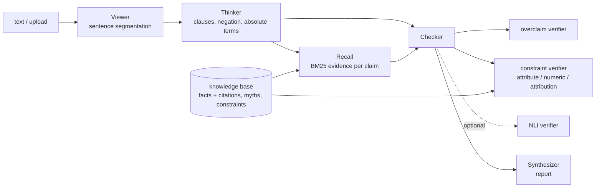

# Neuromorphic Claims Reviewer

A rule-based reviewer for writing **about** neuromorphic computing. Paste text or upload a
document; it flags sentences that overclaim ("SNNs always beat ANNs") or contradict a small
cited knowledge base ("TrueNorth supports on-chip learning", "IBM's Loihi", "TrueNorth has
one billion neurons"), and shows the fact and source behind each factual finding.

Forked from [amisha-sinobann/neuromorphic-multiagent](https://github.com/amisha-sinobann/neuromorphic-multiagent)
and substantially reworked. What changed and why: [docs/IMPROVEMENTS.md](docs/IMPROVEMENTS.md).

## What this is and is not

- It **is** a deterministic text checker: sentence segmentation, negation-aware rules,
  BM25 retrieval over 29 cited facts, and an optional NLI model. No GPU, no API key.
- It is **not** a neuromorphic system. There are no spiking neurons in it; neuromorphic
  computing is the subject of the documents it reviews.
- It is **not** a multi-agent system in the research sense. The five "agents" are stages of
  a pipeline that share a blackboard. The names are kept because the UI is built on them.
- It does **not** verify documents. A sentence with no flag has not been confirmed; it
  only did not match anything the tool knows how to check.

## Quick start

```bash
pip install -r backend/requirements.txt
```

```bash
bash start.sh
```

Open http://localhost:8000. Requires Python 3.10+.

Try pasting:

```
Neuromorphic computing always replaces GPUs because spiking neural networks are more accurate and use zero energy when idle. Intel Loihi and IBM TrueNorth both support rich on-chip learning with STDP. SNNs guarantee better energy efficiency in all cases.
```

All three sentences are flagged. Now paste the corrected version:

```
Neuromorphic chips do not replace GPUs; SNNs are not always more accurate than ANNs. Loihi supports on-chip learning, whereas TrueNorth does not. For sparse workloads, SNNs can be more energy efficient.
```

Nothing is flagged. (The original project flagged this text too.)

## Example: Python

```python
import sys; sys.path.insert(0, "backend")
from agents import MultiAgentOrchestrator, PipelineConfig

reviewer = MultiAgentOrchestrator()                      # default: rule verifiers
result = reviewer.process_document("IBM's Loihi chip has one billion neurons and always beats GPUs.")
for issue in result["potential_issues"]:
    print(issue["type"], "-", issue["explanation"])
    for ev in issue["evidence"]:
        print("   evidence:", ev["content"], f"[{ev['citation']}]")
```

Configuration (`PipelineConfig`):

| Field | Default | Meaning |
|---|---|---|
| `verifiers` | `("overclaim", "constraints")` | which rule verifiers run |
| `negation_aware` | `True` | `False` reproduces the original's polarity blindness (for ablation) |
| `top_k` | `3` | evidence facts retrieved per claim |
| `max_claims` | `5000` | safety cap; exceeding it is reported in the trace |
| `nli` | `False` | add the NLI verifier (needs `pip install torch transformers`, downloads about 330 MB) |
| `nli_myth_threshold` | `0.9` | flag when P(claim entails a known myth) is at least this |
| `nli_contradiction_threshold` | `None` | off; see [BENCHMARKS](docs/BENCHMARKS.md) section 5 for why |

## Example: HTTP

```bash
curl -s -X POST localhost:8000/api/review-text -H "Content-Type: application/json" -d "{\"text\": \"TrueNorth supports rich on-chip learning with STDP.\"}"
```

| Endpoint | Body | Notes |
|---|---|---|
| `POST /api/review-text` | `{"text": "..."}` | 400 if under 20 characters, 422 if malformed |
| `POST /api/review` | multipart `file` | `.txt`, `.pdf`, `.docx`; 10 MB limit; nothing is stored |
| `GET /api/health` | | |

Set `REVIEWER_NLI=1` before starting the server to enable the NLI verifier.

## Architecture



```
backend/
  main.py                       FastAPI app
  textutils.py                  tokenising, sentence/clause splitting, negation
  agents/                       viewer, thinker, recall, checker, synthesizer, orchestrator
  agents/verifiers.py           overclaim, constraints, NLI
  knowledge/neuromorphic_kb.py  facts, myths, constraints, BM25 index
  services/document_processor.py
  static/index.html             built-in UI
frontend/                       optional Next.js UI (npm install && npm run dev)
tests/                          90 pytest cases
benchmarks/                     labelled data, evaluation scripts, recorded results
docs/                           audit, proposal, improvements, benchmarks, future research
```

Adding knowledge is adding a record to `backend/knowledge/neuromorphic_kb.py`: a `Fact`
with a citation, and optionally a constraint that points at it. A test fails if any fact
trips a constraint.

## Testing

```bash
pip install -r requirements-dev.txt
```

```bash
python -m pytest tests -q
```

90 tests: text utilities, each verifier, knowledge-base invariants, pipeline edge cases,
and the HTTP API. The built-in UI has no automated test.

## Benchmark reproduction

```bash
bash benchmarks/reproduce.sh
```

Add `--nli` for the NLI rows. Results are written to `benchmarks/results/`. Summary
(details, method and caveats in [docs/BENCHMARKS.md](docs/BENCHMARKS.md)):

| | Original | This version |
|---|---|---|
| F1 on 70 held-out labelled claims | 0.400 | 0.971 |
| Correct denials of a myth wrongly flagged | 7 / 10 | 0 / 10 |
| Sentences flagged in 736 sentences of unseen Wikipedia prose | 6.8% | 1.8% |
| Part of a 1000-sentence document examined | 12 sentences | all |
| Time for 1000 sentences | 3 ms (reads 12) | 126 ms (reads all) |

The benchmark sentences were written by the same person as the rules, so the F1 is an
upper bound. The Wikipedia row is the more honest one.

## Known limitations

- **False alarms on true universal statements.** "A correlation matrix is always
  positive-definite" is flagged as an overclaim. On unseen Wikipedia prose about 1 sentence
  in 55 is flagged, and none of those flags was a real problem.
- **Small knowledge base** (29 facts). Errors about anything else are invisible.
- **Paraphrase.** Errors phrased without the words the rules look for are missed.
- **Sentence at a time**, English only, no pronoun resolution.
- **Heuristic negation scope**, no syntactic parse.
- **The NLI verifier does not currently help** and is off by default.
- **Energy use was not measured.** Nothing here supports an efficiency claim.

Next steps and open questions: [docs/FUTURE_RESEARCH.md](docs/FUTURE_RESEARCH.md).
Audit of the original: [docs/ARCHITECTURE_AUDIT.md](docs/ARCHITECTURE_AUDIT.md).
Design rationale: [docs/ARCHITECTURE_PROPOSAL.md](docs/ARCHITECTURE_PROPOSAL.md).
