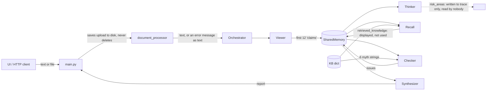

# Architecture audit of the original project

Subject: `amisha-sinobann/neuromorphic-multiagent` at commit `d80de35` ("Initial project
upload", the only commit; no issues, no other branches, no tests). Every defect below was
reproduced by running the original code, not inferred from reading it.

## 1. What the project actually is

The name suggests a neuromorphic multi-agent system. It is neither. It is a **rule-based
document reviewer whose subject matter is neuromorphic computing**: you paste text about
SNNs or neuromorphic chips and it flags sentences that look like overclaims or known myths.

| Claimed or implied | Reality in `d80de35` |
|---|---|
| Neuromorphic computing | None. No neurons, spikes, plasticity, timing or event-driven execution. "Neuromorphic" is the topic of the documents, not the mechanism. |
| Multi-agent system | Five classes called in a fixed order by a `for` loop over one shared dataclass. No autonomy, no messages between agents, no negotiation, no concurrency. |
| "Anti-hallucination" | There is no generative model in the system, so there is nothing that could hallucinate. The phrase refers to flagging overclaims in the *input*. |
| Knowledge grounding | A 124-line Python dict. It is retrieved and displayed, but the component that decides what to flag never reads the retrieved items (defect D2). |
| Agent confidence | Five hard-coded constants (0.95, 0.88, 0.92, 0.85, 0.90), identical for every document. |
| Learning / adaptation | None. |

What it does do, and what is worth preserving: a clear product idea (catch overclaims and
factual slips in neuromorphic writing), a readable staged design, a working FastAPI server
and two UIs that show the trace of each stage.

## 2. Repository structure

```
backend/
  main.py                     FastAPI app: /, /api/health, /api/review (upload), /api/review-text
  agents/base.py              AgentRole, AgentMessage, SharedMemory, BaseAgent
  agents/viewer.py            sentence split + keyword filter -> "claims" (max 12)
  agents/thinker.py           substring match on 10 risk phrases -> metadata only
  agents/recall.py            keyword search over the KB for the first 8 claims
  agents/checker.py           3 rule sets -> issues
  agents/synthesizer.py       counts issues, emits canned recommendations
  agents/orchestrator.py      runs the five in sequence
  knowledge/neuromorphic_kb.py  dict of facts + 6 "myth" strings + substring search
  services/document_processor.py  txt / pdf / docx text extraction
  static/index.html           built-in UI (vanilla JS)
frontend/                     optional Next.js UI calling the same API
start.sh                      uvicorn launcher
```

859 lines of Python. Dependencies: fastapi, uvicorn, python-multipart, pypdf, python-docx.
No tests, no CI, no configuration, no logging, no benchmark, no evaluation data.

## 3. Original architecture and data flow



The dashed and "not used" edges are the central architectural finding: **two of the five
stages have no effect on the result.** Deleting `ThinkerAgent` and `RecallAgent` from the
list changes no flag the system raises. The effective pipeline is
`split sentences -> three regex/keyword rules -> count`.

## 4. Core algorithm analysis

**Viewer.** Splits on `(?<=[.!?])\s+`, keeps a sentence if it contains any of 24 keywords as
a *substring* or is long, then truncates to 12.

**Thinker.** Looks for 10 literal phrases and for hardware names; stores the result in trace
metadata. Nothing downstream reads it.

**Recall.** For the first 8 claims, scores each KB entry by how many whitespace-separated
query words occur as substrings of the entry. Stores up to 3 entries per claim.

**Checker.** Three independent rule sets:
1. *Myth overlap*: flag (high) if the claim shares at least 3 words of 4+ letters with any myth string.
2. *Absolute language*: flag (medium) on `always|never|guarantees?|perfect|zero energy|...`.
3. *Hardware rules*: three `if all(terms in claim) and not any(safe in claim)` substring rules.

**Synthesizer.** Counts issues and returns one of two fixed recommendation lists.

## 5. Confirmed defects

Each row was reproduced; the "verify" column names the test that now guards it or the
command that shows it. Severity is impact on the project's stated purpose.

| # | Defect | Where | Impact | Verify |
|---|---|---|---|---|
| D1 | **Polarity blindness: correct statements that deny a myth are flagged as the myth.** "TrueNorth does not support on-chip learning" is flagged high severity; so is "SNNs are not always more accurate than ANNs" (three issues). The myth strings contain their own corrections, so word overlap matches text that agrees with them. | `checker.py:25-41`, `:49-63` | Critical. 7 of 10 correct negations in the held-out set are flagged; overall accuracy is 0.486, below coin-flipping. | `run_eval.py --system baseline --split test` |
| D2 | Checker never reads the retrieved knowledge (`knowledge = memory.retrieved_knowledge` is assigned and unused). | `checker.py:13` | Critical for the "grounded" claim: no flag is ever supported by evidence. | grep; `test_issue_carries_cited_evidence` |
| D3 | Thinker output (`risk_areas`) is read by no other component. | `thinker.py:79` | Stage is decorative. | grep across `agents/` |
| D4 | **Silent truncation to 12 claims** (and Recall only looks at 8). Everything after roughly the first paragraph of a paper is never examined, and nothing says so. | `viewer.py:43`, `recall.py:21` | Critical for real documents: recall on gold errors drops from 0.80 (10 sentences) to 0.12 (100 sentences). | `perf.py --system baseline`; `test_long_documents_are_checked_to_the_end` |
| D5 | Claim filter uses substring keywords: `"is"` matches "Th**is**", so nearly every sentence is a "claim" and the filter does nothing. | `viewer.py:24-39` | Low on its own; makes D4 worse because junk fills the 12 slots. | section 6, item 2 |
| D6 | Sentence splitter breaks on abbreviations: "Davies et al. introduced Loihi" becomes fragments, and the fragment "introduced Loihi in 2018." is checked without its subject. | `viewer.py:22` | Medium: academic text is full of "et al.", "e.g.", "i.e.". | `test_sentences_not_split_on_abbreviations` |
| D7 | Safe-word check is a substring test: `"not"` matches "**not**able", so "TrueNorth offers notable on-chip learning" escapes the rule. | `checker.py:69,88` | Medium: false negatives. | section 6, item 3 |
| D8 | Retrieval matches stopwords as substrings. The queries `"the of a is"` and "rainfall in Paris is high" both return five neuromorphic facts, always the same five (ties keep dict order). | `neuromorphic_kb.py:101-116` | High for retrieval quality: recall@1 of the relevant fact is 0.02 (original scorer run over the revised KB). | `retrieval_eval.py` |
| D9 | Text of 20-49 characters passes the endpoint check (>= 20) but fails the orchestrator check (>= 50), which returns `{"error": ...}` with HTTP 200. The UI then renders an empty result. | `main.py:119`, `orchestrator.py:24` | Medium: silent failure. | `test_review_text_rejects_bad_payloads` |
| D10 | `payload: dict` is unvalidated: `{"text": 123}` raises `AttributeError` and returns HTTP 500. | `main.py:116-118` | Medium. | same test |
| D11 | Extraction failures are returned as text (`"[PDF extraction error: ...]"`). A corrupt PDF is therefore "reviewed" as a one-sentence document about a PDF error. | `document_processor.py:25,34,40` | Medium: wrong output presented as a result. | `test_corrupt_pdf_is_an_error_not_a_reviewed_document` |
| D12 | Uploads are written to `backend/uploads/` and never deleted. | `main.py:83-88` | Medium: unbounded disk growth, and users' documents are retained without notice. | `test_uploads_are_not_written_to_disk` |
| D13 | No upload size limit; the whole file is copied to disk and parsed. | `main.py:85` | Medium: trivial denial of service. | `test_unsupported_type_and_oversize_rejected` |
| D14 | `.doc` is accepted but python-docx cannot read it; the result is D11. | `main.py:73` | Low. | same test |
| D15 | **DOM XSS in the built-in UI**: claims, explanations and suggestions from the reviewed document are interpolated into `innerHTML` unescaped. A document containing `` runs script in the reviewer's browser. | `static/index.html:217-240` | High for a tool whose input is untrusted documents. | read the template; fixed with an `esc()` helper |
| D16 | CPU-bound pipeline runs inside `async def` endpoints, blocking the event loop for all other requests. | `main.py:63,116` | Low at current speed; grows with D4 fixed. | code |
| D17 | CORS `allow_origins=["*"]` together with `allow_credentials=True`. | `main.py:33-39` | Low (no credentials exist) but an invalid combination that browsers reject. | code |
| D18 | Hard-coded confidences presented to the user as percentages. | every agent | Research validity: a displayed number with no measurement behind it. | `test_no_hard_coded_confidences` |
| D19 | One KB fact is wrong: Loihi was introduced in *IEEE Micro* (Davies et al., 2018), not in "Nature papers". Also `datetime.utcnow()` is deprecated in Python 3.12. | `neuromorphic_kb.py:80`, `base.py:24` | Low. | corrected in the KB |
| D20 | The same claim is counted once per rule set, so "issues found" overstates the number of problematic sentences (the README example reports 6 issues for 3 sentences). | `checker.py:99-105` | Low: misleading headline number. | report now gives `claims_flagged` separately |

No race conditions exist in the original: the orchestrator holds no per-request state and
each request builds its own `SharedMemory`. No memory leak in process memory; the leak is on
disk (D12).

## 6. Reproduction transcript (original code)

```
1  "TrueNorth does not support on-chip learning; ..."      -> ['possible_common_mistake']
   "SNNs are not always more accurate than ANNs, ..."       -> ['possible_common_mistake',
                                                               'overclaim_absolute_language',
                                                               'hardware_capability_risk']
2  "This weather report mentions sunshine today."            -> extracted as a scientific claim
3  "TrueNorth offers notable on-chip learning ..."           -> no issue (safe word 'not' in 'notable')
4  search_knowledge("the of a is")                           -> 5 facts
   search_knowledge("rainfall in Paris is high")             -> the same 5 facts
6  "SNNs always beat ANNs, guaranteed." (34 chars)           -> HTTP 200 {"error": ...}
7  corrupt .pdf                                              -> "[PDF extraction error: ...]" reviewed as text
8  "Davies et al. introduced Loihi in 2018. It has approx. 130,000 neurons, i.e. far fewer ..."
                                                             -> ['introduced Loihi in 2018.',
                                                                 '130,000 neurons, i.e.',
                                                                 'far fewer than TrueNorth.']
10 agent confidences for any input                           -> [0.95, 0.88, 0.92, 0.85, 0.9]
```

## 7. Evaluation against the three requested dimensions

### A. Neuromorphic correctness
There is nothing to evaluate. The system contains no neuron model, encoding, temporal state,
plasticity rule, surrogate gradient or event-driven execution. This is not a criticism of the
code so much as of the name: the task (checking prose against known facts) has no temporal
or sparse-event structure that a spiking model would exploit. See the proposal for why none
was added.

### B. Multi-agent architecture
- *Autonomy / specialisation*: none. Stages are functions with a fixed call order.
- *Communication*: a shared mutable dataclass (a blackboard), no messages.
- *Coordination, conflict resolution, resource allocation*: none needed, none present.
- *Scalability with agent count*: not applicable; the count is fixed at five.
- *Fault tolerance*: an exception in any stage aborts the request.
- *Learning*: none.
- *Does it benefit from multiple agents?* No. It benefits from being *staged*, which is a
  modularity property. Two of the five stages were dead code (D2, D3).

### C. Engineering quality
Covered by section 5. In summary: no tests, no validation, no error taxonomy, one security
defect (D15), one data-retention defect (D12), and a headline capability (D1, D4) that fails
on exactly the inputs a careful author would write.

## 8. How success should be measured

The project's purpose is detection, so it should be judged like a detector:

1. **Precision / recall / F1 of flagged claims** on labelled sentences, including correct
   statements that share vocabulary with myths (the case the original gets wrong).
2. **False-alarm rate on real prose** that nobody on the project wrote.
3. **Coverage**: fraction of a long document actually examined.
4. **Retrieval quality**: is the cited fact the relevant one.
5. Latency and memory as documents grow.

The original had none of these. `docs/BENCHMARKS.md` reports all five for the original and
the revised system.

## 9. Research-validity concerns

- No evaluation existed, so no claim about the tool's usefulness was supported.
- The UI vocabulary ("agents", "internal reasoning", "confidence 95%", "anti-hallucination")
  describes capabilities the code does not have.
- A fact-checker that flags true statements (D1) is worse than no checker for a careful
  author, because it trains the user to ignore it.
