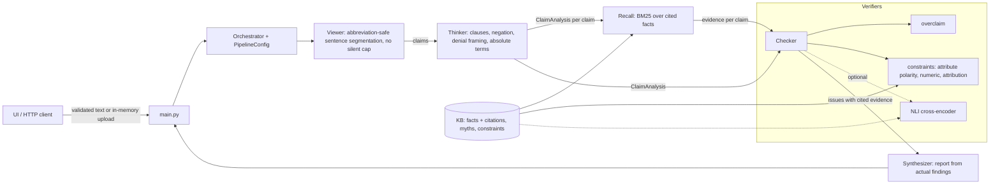

# Architecture proposal

Written after the audit (`ARCHITECTURE_AUDIT.md`) and after the baseline was measured
(`BENCHMARKS.md`). The design goal is the project's own: **flag overclaims and factual
errors in writing about neuromorphic computing, and do not flag correct writing.**

## 1. What limits the original

Ranked by measured impact on that goal:

1. It cannot tell a claim from its denial (audit D1). 7 of 10 correct negations flagged.
2. It examines only the first 12 sentences (D4).
3. Its findings cite no evidence, because the checking stage ignores the retrieved
   knowledge (D2), and retrieval returns the same five facts for anything (D8).
4. Its factual checks are three hand-written substring rules; numbers and attribution are
   not checked at all.

None of these is a capacity problem that a bigger model fixes by default. 1 is a polarity
problem, 2 is a bug, 3 is a wiring and retrieval problem, 4 is a knowledge-representation
problem.

## 2. Candidate directions

Each candidate is assessed on the same seven points: limitation addressed, why it fits,
evidence, expected advantage, cost, integration effort, and how to test it.

### A. Negation- and scope-aware rule verification over a structured KB  (selected)

- **Addresses**: limitations 1, 3, 4.
- **Why it fits**: the errors to catch are of a few regular kinds: an entity is given a
  property it lacks (TrueNorth, on-chip learning), a number is wrong, a chip is credited to
  the wrong organisation, or a statement is universally quantified. Each can be written as
  a small constraint plus a polarity test. The polarity test is the well-studied problem of
  negation detection, for which a cue-and-scope rule method is a strong baseline.
- **Evidence**: NegEx (Chapman et al., *J. Biomed. Inform.* 34(5), 2001) showed that a
  cue-list-plus-window algorithm identifies negated findings in clinical text with high
  specificity; cue/scope methods remain the standard baseline for negation. For overclaim
  wording, Hyland's work on hedges and boosters in research articles (*Hedging in Scientific
  Research Articles*, 1998; *Discourse Studies* 7(2), 2005) establishes that unhedged
  boosters are a recognisable, lexically marked class; the absolutist word list of
  Al-Mosaiwi & Johnstone (*Clin. Psychol. Sci.* 6(4), 2018) is the seed for the lexicon.
- **Advantages**: deterministic, sub-millisecond, no model download, every finding points
  at a cited fact, and each constraint is one data record.
- **Costs**: knowledge must be hand-encoded; no generalisation to paraphrase; negation
  scope is approximated without a parser.
- **Integration**: moderate. New KB schema and verifier module; existing stages keep their
  names and the API keeps its shape.
- **Test**: precision/recall on labelled claims, with an ablation that switches negation
  handling off.

### B. Lexical retrieval with BM25  (selected)

- **Addresses**: limitation 3 (D8).
- **Why it fits**: the KB is about 30 short facts with distinctive vocabulary (chip names,
  rule names). Term weighting by inverse document frequency is exactly what separates
  "TrueNorth" from "is".
- **Evidence**: Robertson & Zaragoza, "The Probabilistic Relevance Framework: BM25 and
  Beyond", *Found. Trends Inf. Retr.* 3(4), 2009. BM25 is the standard first-stage retriever
  in fact-verification pipelines such as FEVER (Thorne et al., NAACL 2018) and SciFact
  (Wadden et al., EMNLP 2020).
- **Advantages**: about 30 lines, no dependency, interpretable scores.
- **Costs**: no synonym or paraphrase matching.
- **Integration**: trivial (one function).
- **Test**: recall@k of the fact a constraint cites, against the original scorer on the
  same KB; number of facts returned for off-topic sentences.

### C. NLI cross-encoder as a verifier  (implemented, evaluated, left off by default)

- **Addresses**: paraphrased errors that no rule anticipates.
- **Why it fits**: "does this claim contradict this fact" is natural-language inference,
  and retrieve-then-NLI is the standard architecture for claim verification.
- **Evidence**: FEVER and SciFact (above); NLI as a factual-consistency metric in Honovich
  et al., "TRUE", NAACL 2022. Model: `cross-encoder/nli-MiniLM2-L6-H768`, a MiniLMv2
  (Wang et al., Findings of ACL 2021) cross-encoder trained on SNLI and MultiNLI (Williams
  et al., NAACL 2018).
- **Expected advantage**: recall on paraphrases.
- **Costs**: torch + transformers, a 330 MB download, roughly 300 times the latency, and
  the known failure modes of small NLI models out of domain.
- **Integration**: low, behind a config flag.
- **Test**: threshold sweep on dev, then one run on test, alone and combined with A.
- **Outcome**: it did not earn a place in the default pipeline. See section 4.

### D. LLM-based multi-agent verification (debate / critique)  (not implemented)

- **Addresses**: open-ended claims outside any KB; would make the "agents" real.
- **Evidence**: Du et al., "Improving Factuality and Reasoning in Language Models through
  Multiagent Debate", arXiv:2305.14325, 2023; retrieval-augmented generation, Lewis et al.,
  NeurIPS 2020.
- **Why not now**: it changes what the project is (an offline, deterministic, dependency-light
  tool becomes an API client with per-document cost and non-determinism), and it would add
  a component that can itself hallucinate to a tool whose purpose is to catch that.
  It also cannot be evaluated responsibly on 140 author-written sentences. It is the natural
  next step once a larger labelled set exists; see `FUTURE_RESEARCH.md`.

### E. A spiking neural network component  (rejected)

This was considered seriously because of the project's name. Options examined: an SNN text
classifier trained with surrogate gradients (snnTorch or Norse) for overclaim detection; an
STDP-based associative memory in place of BM25; spike encoding of token embeddings.

- **Limitation it would address**: none of the four in section 1.
- **Theoretical fit**: poor. The case for SNNs rests on temporal structure in the input and
  on sparse, event-driven execution on neuromorphic hardware (Roy, Jaiswal & Panda, *Nature*
  575, 2019). A sentence checked against a knowledge base has neither; and on a CPU or GPU a
  simulated SNN is slower than the equivalent ANN, not more efficient.
- **Evidence**: spiking language models exist (Lv et al., "Spiking Convolutional Neural
  Networks for Text Classification", ICLR 2023; Zhu et al., "SpikeGPT", arXiv:2302.13939,
  2023). Their reported result is approaching ANN accuracy at lower *estimated* energy on
  neuromorphic hardware, not exceeding it. There is no accuracy argument for using one here.
- **Cost**: a training corpus that does not exist (the benchmark has 140 sentences), a
  PyTorch dependency in the core path, and an energy claim that could not be measured on
  the available hardware.
- **Decision**: adding it would be using neuromorphic terminology, which is the thing the
  audit criticises. It is recorded as a hypothesis with a concrete experiment in
  `FUTURE_RESEARCH.md`, not built.

### F. Real multi-agent coordination (decentralised agents, message passing, voting)

- **Limitation it would address**: none. The stages have a fixed linear dependency:
  segmentation must precede analysis, which must precede checking. There is no contention
  for resources, no partial observability and no conflicting goals, which are the
  conditions under which agent autonomy pays for its overhead (Wooldridge & Jennings,
  "Intelligent agents: theory and practice", *Knowl. Eng. Rev.* 10(2), 1995).
- **Decision**: keep the staged pipeline over a shared blackboard (Nii, "Blackboard
  Systems", *AI Magazine* 7(2), 1986), make every stage's output load-bearing, and describe
  it as a pipeline. The one place where independence is real, the verifiers, is implemented
  as independent functions that can be enabled and measured separately.

## 3. Selected design

Design rules:

1. **Every stage's output is consumed.** The Thinker's `ClaimAnalysis` (clauses, negation,
   denial, absolute terms) is the input of both rule verifiers; Recall's per-claim evidence
   is attached to findings and is the premise set for NLI.
2. **Knowledge is data.** Facts carry citations; constraints reference facts. Adding a
   check is adding a record to `knowledge/neuromorphic_kb.py`.
3. **Polarity is explicit.** A constraint states whether the entity *has* the property.
   A claim violates it when a clause mentions the entity and asserts the opposite, where
   "asserts" accounts for negation cues, contrast clauses ("unlike X", "whereas"), and
   sentence-level denial ("it is a myth that").
4. **Abstain rather than guess.** Hedged or first-person empirical claims are exempt from
   generic constraints; numbers are checked only when a clause names exactly one chip.
5. **Verifiers are independent and switchable**, so each one's contribution is measurable.
6. **No number without a measurement.** Hard-coded confidences are removed.
7. **The API response keeps its original keys**, so both UIs keep working.

## 4. What the evidence did to the plan

| Proposal | Prediction | Measured (held-out test unless noted) | Decision |
|---|---|---|---|
| A, negation handling | removes false positives on correct denials | 10 false positives with it off, 0 with it on; precision 0.77 to 1.00 | keep |
| A, constraints | catches factual errors rules of the original missed | 14/14 factual errors (original 2/14) | keep |
| B, BM25 | cited fact retrieved | recall@3 0.89 vs 0.15 for the original scorer | keep |
| C, NLI contradiction arm | catches paraphrased errors | +1 true positive, +2 false positives, 136 ms/claim; on dev it called 4 correct statements contradictions with P >= 0.92 | **off by default** |
| C, NLI myth arm | catches restated myths | precise (0 FP) but found nothing the rules had not; 64 ms/claim vs 0.2 | **off by default** |
| A, overclaim lexicon | precise on real text | **not as predicted**: 9 flags on 444 Wikipedia sentences, all false alarms. Lexicon narrowed; on five further unseen articles 13 of 736 sentences flagged, still all false alarms | keep, with the limitation stated prominently |

The NLI contradiction arm fails for an identifiable reason: the premise is a multi-sentence
fact, and the model treats "TrueNorth has no on-chip learning" as contradicting a retrieved
fact that says *Loihi* supports it. Sentence-level premises are the known remedy (Laban et
al., "SummaC", *TACL* 10, 2022) and are listed as future work rather than tuned here.

## 5. Migration strategy

Done in this order. The benchmark and the original's results were committed before any
backend change, and the implementation was committed before the held-out split was run:

1. Freeze a labelled benchmark and record the original's results (no code changes).
2. Replace KB, text analysis, verifiers and agents; keep API keys and stage names.
3. Fix the API layer (validation, status codes, in-memory uploads, size cap) and the XSS.
4. Add tests.
5. Evaluate on the held-out split once; run ablations; run real-prose check.
6. Document.

Rollback is `git checkout d80de35 -- backend frontend` for the whole change, or reverting
any single commit. Nothing was deleted that the new code does not replace: the upload
directory and `extract_text_from_bytes` (unused in the original) are the only removals.
