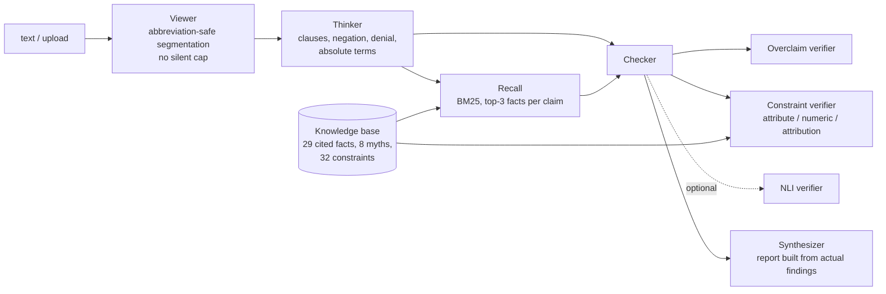

# Technical Report: Neuromorphic Claims Reviewer

How the system works, what was wrong with the original, what was changed, and what the
changes measurably achieved. Every number in this report comes from
`bash benchmarks/reproduce.sh --nli`, and the raw outputs are in `benchmarks/results/`.
Shorter, topic-specific versions are in the other files under `docs/`.

---

## 1. Problem statement

Writing about neuromorphic computing contains recurring errors:

- **Overclaims**: "SNNs always outperform ANNs", "zero energy when idle".
- **Factual slips**: "TrueNorth supports on-chip learning", "IBM's Loihi", "TrueNorth has
  one billion neurons".
- **Restated myths**: "GPUs are obsolete now that neuromorphic chips exist".

The tool takes a document (pasted text, `.txt`, `.pdf` or `.docx`) and should flag those
sentences while **leaving correct sentences alone**. That second requirement is where the
original failed.

---

## 2. The original system (commit `d80de35`)

### 2.1 Pipeline

```
text -> Viewer -> Thinker -> Recall -> Checker -> Synthesizer -> report
```

| Stage | What it actually did |
|---|---|
| Viewer | Split text on `. ! ?` followed by whitespace, kept sentences containing any of 24 keywords **as substrings**, then truncated to **12 claims** |
| Thinker | Matched 10 literal risk phrases and saved them in trace metadata. **Nothing else read that output.** |
| Recall | For the **first 8 claims only**, scored knowledge-base entries by counting query words found as substrings |
| Checker | Applied three rule sets: myth word-overlap (3+ shared words of 4+ letters), an absolute-word regex, and 3 hardware substring rules. **It never read Recall's output.** |
| Synthesizer | Counted issues and returned one of two fixed recommendation lists |

The project had 859 lines of Python, 0 tests, no evaluation data and no benchmark.

### 2.2 What the name suggested versus what the code did

| Implied by the name or UI | Reality |
|---|---|
| Neuromorphic computing | No neurons, spikes, plasticity or event-driven execution. Neuromorphic computing is only the *topic* of the documents. |
| Multi-agent system | Five classes called in a fixed `for` loop over one shared object. No messages, autonomy or coordination. |
| Knowledge grounding | Retrieved facts were displayed but never used to decide anything. |
| Agent confidence (95%, 88%...) | Five hard-coded constants, the same for every document. |

### 2.3 Confirmed defects

Twenty defects were found, and every one was reproduced by running the code. The most
important:

| # | Defect | Measured effect |
|---|---|---|
| D1 | **Polarity blindness.** "TrueNorth does **not** support on-chip learning" is flagged as a high-severity mistake, because the myth strings contain their own corrections and the checker only counts word overlap. | 7 of 10 correct denials flagged; overall accuracy **0.486**, below a coin flip |
| D2 | Checker ignored the retrieved knowledge | No finding was backed by evidence |
| D3 | Thinker output read by no one | The stage had no effect on results |
| D4 | **Silent cap of 12 claims** | For a 100-sentence document, recall on gold errors fell from 0.80 to **0.12** |
| D5 | Keyword `"is"` matched "Th**is**" | The claim filter let almost every sentence through |
| D6 | Splitter broke on "et al.", "e.g.", "i.e." | Fragments such as "introduced Loihi in 2018." were checked without their subject |
| D7 | Safe word `"not"` matched "**not**able" | A false-claim rule was silently bypassed |
| D8 | Retrieval matched stopwords | "the of a is" and "rainfall in Paris" each returned 5 neuromorphic facts; recall@1 of the right fact was **0.021** |
| D9 to D14 | API: HTTP 200 with an error body for 20 to 49 character input, 500 on non-string input, PDF errors reviewed *as text*, uploads kept on disk forever, no size limit, `.doc` accepted but unreadable | Wrong output or silent failures |
| D15 | **DOM XSS**: document text was inserted into `innerHTML` unescaped | A document could run script in the reviewer's browser |
| D18 | Hard-coded confidences shown as percentages | Numbers with no measurement behind them |
| D20 | One sentence counted once per rule | The README example reported 6 "issues" for 3 sentences |

The full table with file and line references is in `ARCHITECTURE_AUDIT.md`.

---

## 3. Method: measure first, then change

The order of work was fixed in advance so the results could not be tuned to the test data.

1. **Write a labelled benchmark**: two splits of 70 sentences each, 35 that should be
   flagged and 35 that should not.
2. **Commit it (`2e2b0bb`) together with the original's scores**, before any backend change.
3. Develop against the **dev** split only.
4. **Commit the implementation (`ddde84f`)** before running the **test** split for the
   first time.
5. Run ablations, a retrieval comparison, a scaling benchmark, and a check on real
   Wikipedia prose that neither the system nor the benchmark author had seen.

### 3.1 Benchmark composition (per split)

| Category | Gold label | Count | Purpose |
|---|---|---|---|
| overclaim | flag | 12 | absolute or universal wording |
| factual_error | flag | 14 | wrong property, number or attribution |
| paraphrased_myth | flag | 9 | a myth stated without any trigger words |
| correct_fact | ok | 12 | true statements about the same entities |
| **correct_negation** | ok | 10 | true statements that *deny* a myth using its own words |
| hedged | ok | 8 | properly qualified claims |
| neutral | ok | 5 | prose with no checkable claim |

`correct_negation` is the category that exposes polarity-blind checkers like the original.

### 3.2 Protocol

Each sentence is submitted as its own document, and the prediction is "flag" if any issue
is raised. The system is deterministic, so there are no random seeds to vary. Uncertainty
over *which* sentences happen to be in the benchmark is reported as a 95% bootstrap
confidence interval (2000 resamples).

---

## 4. The new architecture



The five stage names were kept so the existing UIs and API still work. The difference is
that **every stage's output is now used** by a later stage.

### 4.1 Text analysis (`backend/textutils.py`)

- **Sentence splitting** does not break after "et al.", "e.g.", "i.e.", "approx.", "Fig."
  or initials. Blank lines end a sentence; single newlines (as in PDF output) do not.
- **Clause splitting** breaks at contrast markers: `;`, "whereas", "while", "but",
  "although", "however", "unlike", "instead of", "rather than". This is why
  "Loihi supports on-chip learning, whereas TrueNorth does not" is handled correctly: each
  chip is checked inside its own clause.
- **Negation detection** uses a cue-and-window method (the NegEx family of algorithms).
  Cues include *not, no, never, cannot, without, lacks, few, rarely, fails to* and *n't*.
  A cue counts if it comes before the matched property in the same clause, or within
  2 words after it ("on-chip learning is **not** supported").
- **Denial framing**: sentences such as "It is a **myth** that...", "incorrectly",
  "misleading" or "contrary to" flip the polarity of the whole sentence.

### 4.2 Knowledge base (`backend/knowledge/neuromorphic_kb.py`)

| Record type | Count | Role |
|---|---|---|
| `Fact` | 29 | A short statement plus a citation (e.g. Merolla et al., *Science* 2014, for TrueNorth). Retrieved as evidence. |
| `Myth` | 8 | The false claim, its correction, and a link to the supporting fact. Used by NLI. |
| `AttributeConstraint` | 21 | An entity has or lacks a property, e.g. TrueNorth has no on-chip learning, SpiNNaker is not analog, STDP is not supervised. |
| `NumericConstraint` | 6 | Neuron, synapse and core counts for TrueNorth and Loihi. |
| `AttributionConstraint` | 5 | Loihi is Intel's, TrueNorth is IBM's, SpiNNaker is Manchester's, BrainScaleS is Heidelberg's, and Carver Mead coined "neuromorphic". |

Knowledge is data: adding a check means adding a record, not writing code. A test
guarantees the knowledge base never contradicts itself.

### 4.3 Retrieval: Okapi BM25

BM25 scoring uses `k1 = 1.5` and `b = 0.75` over stopword-filtered tokens. Hyphenated words
are indexed both whole and split, so "on-chip" also matches "chip". Each claim receives its
top 3 facts.

### 4.4 Verifiers (`backend/agents/verifiers.py`)

**Overclaim verifier**
- Flags absolute terms such as *always, never, guarantee(d)* and *impossible*; universal
  phrases restricted to scope nouns ("every **workload**" is flagged, "every **timestep**"
  is not); *regardless of, without exception, across the board*; zero-cost phrases such as
  "zero energy"; and totality adverbs only when they modify an outcome ("completely
  **eliminates**", but not "fully spin-polarized").
- A negation cue immediately before the term cancels the flag ("**not** always").
- These findings are rated *medium* severity.

**Constraint verifier**
- *Attribute check*: within a clause that names the entity, is the property asserted or
  negated? A finding is raised if the result disagrees with the constraint. Generic
  constraints about a whole class (e.g. "SNNs are more accurate") are skipped for hedged or
  first-person claims ("our SNN outperforms the baseline").
- *Numeric check*: parses quantities such as "1,000,000", "130k" or "one billion neurons".
  It only checks a number when the clause names exactly one chip, and accepts values within
  a factor of 2 of the documented figure.
- *Attribution check*: catches patterns such as "IBM's Loihi", "Loihi was designed by X" and
  "X introduced the Loihi chip".
- These findings are rated *high* severity and include the cited fact.

**NLI verifier (optional, off by default)**
- Uses `cross-encoder/nli-MiniLM2-L6-H768`.
- Myth arm: flag if P(claim entails a known myth) ≥ 0.9.
- Contradiction arm: flag if P(retrieved fact contradicts the claim) ≥ T. It is disabled
  unless a threshold is given, for the reasons in section 6.

### 4.5 API and UI hardening

- **Validation**: requests use a validated pydantic model. Short text returns 400 and
  malformed input returns 422.
- **Uploads**: handled in memory, never written to disk, with a 10 MB cap (413 beyond it).
  Extraction failures return 422 instead of being reviewed as text.
- **Concurrency**: endpoints run in FastAPI's threadpool, so a long document does not block
  other requests.
- **Network exposure**: the server binds to `127.0.0.1` because it has no authentication.
- **XSS**: all document-derived text in the UI is escaped. This was verified by running the
  page script against an `` payload in every field.
- **Honest numbers**: hard-coded confidences were removed, and the report shows
  `claims_flagged` separately from `issues_found`.

---

## 5. Results

**Environment:** AMD Ryzen 7 9700X, 32 GB RAM, Windows 11, Python 3.12.10, CPU only.

### 5.1 Headline (held-out test split, 70 claims)

| Metric | Original | Revised | Change |
|---|---|---|---|
| Precision | 0.480 | **1.000** | +0.520 |
| Recall | 0.343 | **0.943** | +0.600 |
| F1 | 0.400 [0.235–0.545] | **0.971** [0.921–1.000] | +0.571 (2.4×) |
| Accuracy | 0.486 | **0.971** | +0.485 |
| True positives / false positives | 12 / 13 | **33 / 0** | 13 fewer false alarms |
| False negatives / true negatives | 23 / 22 | **2 / 35** | 21 fewer misses |

On the dev split (used for development) the revised system scores F1 0.986, compared with
0.400 for the original.

### 5.2 Per-category results (sentences flagged / total, test split)

| Category | Target | Original | Revised |
|---|---|---|---|
| overclaim | high | 8/12 (67%) | **12/12 (100%)** |
| factual_error | high | 2/14 (14%) | **14/14 (100%)** |
| paraphrased_myth | high | 2/9 (22%) | **7/9 (78%)** |
| correct_fact | low | 1/12 | **0/12** |
| correct_negation | low | **7/10 (70%)** | **0/10** |
| hedged | low | 4/8 (50%) | **0/8** |
| neutral | low | 1/5 | **0/5** |

The two remaining misses are paraphrases that no rule covers:
- "Online learning on the device is a standard feature across the whole range of
  neuromorphic processors."
- "Training spiking networks directly is cheap and needs far less computation than
  training an equivalent ANN."

### 5.3 Ablations: which part contributes what (test split)

| Configuration | Precision | Recall | F1 | False positives | ms per claim |
|---|---|---|---|---|---|
| **Full default** | 1.000 | 0.943 | **0.971** | 0 | 0.21 |
| Overclaim verifier only | 1.000 | 0.429 | 0.600 | 0 | 0.11 |
| Constraint verifier only | 1.000 | 0.629 | 0.772 | 0 | 0.21 |
| **Negation handling off** | 0.767 | 0.943 | 0.846 | **10** | 0.20 |
| + NLI myth arm | 1.000 | 0.943 | 0.971 | 0 | 63.8 |
| + NLI contradiction arm (T = 0.95) | 0.944 | 0.971 | 0.958 | 2 | 136.1 |
| NLI only, no rules | 1.000 | 0.114 | 0.205 | 0 | 63.8 |

What the ablations show:
- **The two rule verifiers are complementary.** Neither exceeds 0.78 F1 alone; together
  they reach 0.971.
- **Negation handling is the source of the precision.** Without it, 10 false positives
  return, 9 of them on correct denials. That is exactly the original's main failure.
- **NLI did not pay for itself.** The myth arm added nothing at about 300 times the cost.
  The contradiction arm gained one true positive but added two false positives; for
  example, it judged "TrueNorth does not support on-chip learning" to *contradict* the
  knowledge base.

### 5.4 NLI threshold sweep (dev split, NLI alone)

| Contradiction threshold | TP | FP | FN |
|---|---|---|---|
| 0.50 | 23 | 10 | 12 |
| 0.80 | 21 | 4 | 14 |
| 0.90 | 15 | 4 | 20 |
| 0.95 | 13 | 3 | 22 |
| 0.99 | 5 | 2 | 30 |

False positives survive even at a 0.99 threshold, so no threshold makes the contradiction
arm safe with this model and premise format. That is why it is off by default.

### 5.5 Retrieval quality

Both scorers were run over the same knowledge base, on the 47 claims where a constraint
fires; the gold answer is the fact that constraint cites.

| Scorer | Recall@1 | Recall@3 | Facts returned for off-topic text (max 3) |
|---|---|---|---|
| Original substring overlap | 0.021 | 0.149 | 3.0 |
| **BM25** | **0.617** | **0.894** | **1.2** |

BM25 gives a 29× improvement in recall@1 and a 6× improvement in recall@3.

### 5.6 Real prose: false alarms on text nobody here wrote

Every sentence of 50+ characters from Wikipedia articles was submitted, with each article
pinned to a revision ID.

| Article set | Sentences | Original flags | Revised flags |
|---|---|---|---|
| Tuning set (3 articles) | 444 | 15 (3.4%) | 4 (0.9%) |
| **Held-out set (5 articles, run once)** | 736 | **50 (6.8%)** | **13 (1.8%)** |

On the held-out set this is a **3.8× reduction in the false-alarm rate**. However, all 13
remaining flags were judged by hand to be false alarms:

| Kind | Count | Example |
|---|---|---|
| True mathematical or physical universals | 7 | "a correlation matrix is always positive-definite" |
| Ordinary absolute words | 3 | "people who have never played the piano" |
| Attribute constraint misfire | 2 | "...temporal codes while maintaining the same mean firing rate" |
| Numeric misfire | 1 | "the human brain's 800 trillion synapses... behind IBM's TrueNorth" |

### 5.7 Coverage, speed and memory

The test documents were built by cycling the 140 benchmark sentences. Times are the median
of 5 runs; memory is the peak traced Python allocation.

| Sentences | Original time | Sentences the original examined | Original recall | Revised time | Revised recall | Revised peak memory |
|---|---|---|---|---|---|---|
| 10 | 1.0 ms | 10 | 0.800 | 1.4 ms | 1.000 | 0.02 MiB |
| 100 | 1.3 ms | **12** | 0.123 | 13.3 ms | 0.985 | 0.22 MiB |
| 1000 | 3.1 ms | **12** | 0.114 | 126 ms | 0.957 | 2.1 MiB |
| 5000 | 10.8 ms | **12** | 0.114 | 628 ms | 0.957 | 10.4 MiB |

- The original only looks fast because it stops reading after 12 sentences. Per sentence
  actually examined, both cost about **0.2 ms**.
- The revised system scales linearly: about **0.13 ms and 2.1 KiB per sentence**.
- Profile breakdown: Checker 57%, Recall 21%, Thinker 16%, Viewer 6%. Most of the time is
  spent in regex matching. No optimisation was needed: a 5000-sentence thesis takes 0.6 s.

### 5.8 Engineering metrics

| | Original | Revised |
|---|---|---|
| Automated tests | 0 | **90** (all passing) |
| Backend Python lines | 859 | about 1,300 |
| Labelled evaluation items | 0 | 140 |
| Reproducible benchmark scripts | 0 | 6 + a one-command runner |
| Known security defects | 1 XSS, unbounded upload storage | 0 known |

---

## 6. What did not work, and why

- **NLI contradiction detection.** The premises were multi-sentence facts that mention
  several chips. The model read "TrueNorth has no on-chip learning" as contradicting a fact
  saying *Loihi* supports it. Splitting facts into single-sentence premises is the known
  remedy, and it is listed as future work.
- **The first overclaim lexicon was too broad.** Its first run on real prose flagged 9
  sentences, all of them false alarms. It was narrowed to outcome adverbs only.
- **One knowledge-base constraint was wrong.** I had asserted that all memristors are
  non-volatile, but volatile memristors exist. A Wikipedia sentence exposed this and the
  constraint was removed.

Both fixes were made *before* the held-out Wikipedia articles were run, and the test-split
F1 was the same before and after them.

---

## 7. Honest limitations

1. **The benchmark and the rules have the same author.** The 0.971 F1 is an upper bound;
   the 1.8% real-prose false-alarm rate is the more trustworthy number.
2. **True universal statements** are flagged ("...is always positive-definite").
3. **The knowledge base has 29 facts.** Errors about anything else are invisible.
4. **Paraphrased errors** are missed (2 of 9 on the test split).
5. The system checks **one sentence at a time**, in English only, with no pronoun
   resolution and heuristic negation scope.
6. **Energy use was not measured.** Nothing here supports an efficiency claim.
7. **Nothing in this system is neuromorphic.** A spiking network was considered and
   rejected, because the task has no temporal or sparse-event structure for one to
   exploit (see `ARCHITECTURE_PROPOSAL.md`, candidate E).

---

## 8. Reproduce

```bash
pip install -r backend/requirements.txt -r requirements-dev.txt
python -m pytest tests -q
bash benchmarks/reproduce.sh          # add --nli for the NLI rows
```

## 9. Further reading

| File | Contents |
|---|---|
| `ARCHITECTURE_AUDIT.md` | All 20 defects with file and line references |
| `ARCHITECTURE_PROPOSAL.md` | Candidate designs, supporting research, and why the spiking and multi-agent designs were rejected |
| `IMPROVEMENTS.md` | A change-by-change log |
| `BENCHMARKS.md` | Full methodology and every table |
| `FUTURE_RESEARCH.md` | Next experiments, separated into established results and hypotheses |
